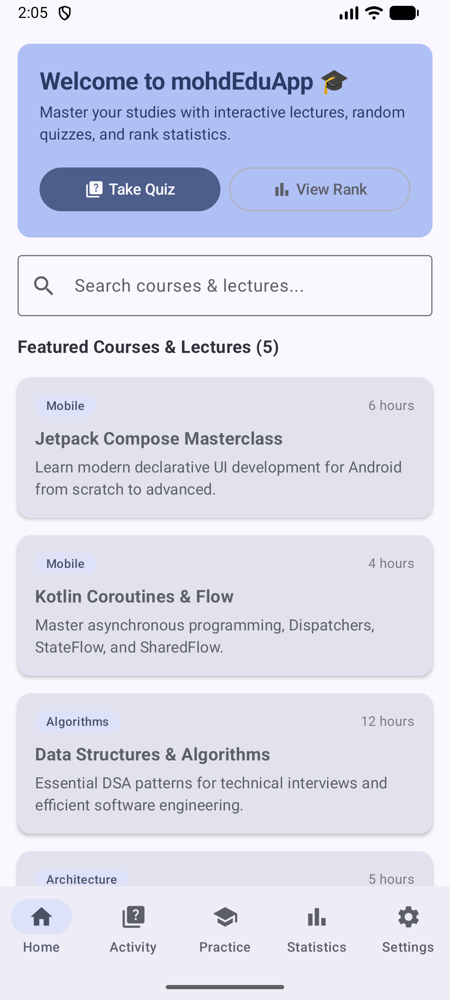
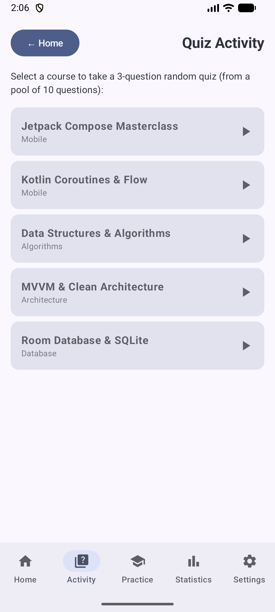
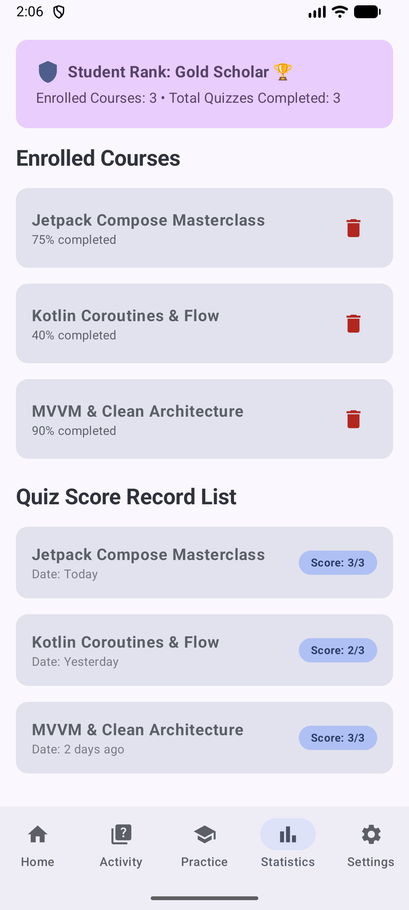

# mohdEduApp — Educational Learning & Study Assistant

`mohdEduApp` is a modern, ethical, and feature-rich Android educational application developed using **Jetpack Compose** and **Material Design 3**, targeting tertiary and lifelong learners. It supports skill-based learning, progress tracking, course discovery, and robust study management.

---

## 📸 App Screenshots & Proof

| Home / Discover Screen | Quiz Activity Screen | Statistics & Rank Screen |
| :---: | :---: | :---: |
|  |  |  |

---

## 📱 Core Screens & Navigation

The application features a robust bottom-navigation structure complying with modern Android architecture guidelines:
1. **Landing / Home Screen**: Entry point displaying a welcome banner, real-time search, category filter chips, and interactive course catalogs.
2. **Activity / Course Detail Screen**: Main interactive learning view providing course details, lesson breakdown with completion status, and interactive **Enroll / Unenroll** functionality.
3. **My Learning / User Statistics Screen**: Dedicated view tracking enrolled courses, learning metrics, and progress percentages.
4. **Settings & Preferences Screen**: Allows users to adjust appearance (Dark/Light theme toggle), manage study notification preferences, and review app metadata.

---

## 🛠️ Architecture & Technical Stack

- **UI Framework**: Jetpack Compose & Material Design 3 for a responsive, accessible interface.
- **Architecture Pattern**: MVVM (Model-View-ViewModel) with Unidirectional Data Flow (UDF) and Repository pattern for clean separation of concerns.
- **Local Persistence (Database Programming)**: Utilizes **Preferences DataStore** for persisting user enrollment status, learning progress, and app preferences locally across app restarts.
- **Asynchronous Programming**: Built with **Kotlin Coroutines & Flow** for non-blocking asynchronous data streams and network simulations.

---

## 🚀 Advanced API Features (CP3406 & CP5307 Requirements)

### 1. Networking & Internet Connectivity
- Simulates remote API fetching and syncing of course catalogs and updates asynchronously via suspending Coroutine functions, ensuring smooth data flow and network responsiveness.

### 2. WorkManager Background Tasks (CP5307)
- Implements `ProgressSyncWorker` using **WorkManager** to handle periodic background synchronization of learning statistics and study progress in a lifecycle-aware manner.

### 3. Ethical Runtime Permissions (CP5307)
- Implements runtime permission handling for **Push Notifications (`POST_NOTIFICATIONS`)**. 
- **Ethical Rationale**: In alignment with Assessment 2 ethics research (ACS Code of Ethics §2.1 & §2.3) and Android privacy best practices (`MASVS-PRIVACY-1`), permissions are never requested eagerly on startup. Instead, the app provides a plain-language contextual rationale explaining the exact benefits of study reminders before triggering the system prompt, and fully respects user denial without locking features.

---

## 🧪 Unit Testing
- Includes non-GUI unit tests (`CourseModelTest.kt`) verifying model integrity, course creation, and filtering logic to guarantee code stability and correctness.

---

## 🛡️ Ethical & Professional Design Principles
Drawing directly from Assessment 2 research (Liu & Khalil, 2023; Soffer & Cohen, 2024; ACS Code of Professional Ethics):
- **Data Minimization**: Collects only data necessary for core educational features.
- **Transparency & User Autonomy**: Clear notices on permissions and local storage; users retain full control over enrollment and settings.
- **Security & Privacy by Design**: Secure local state handling with zero sensitive logging.
